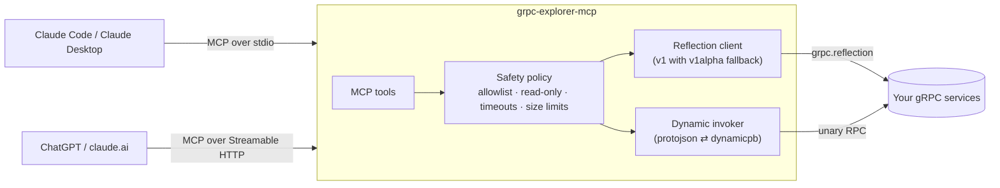

# grpc-explorer-mcp

[](https://github.com/mauricioacevedo/grpc-explorer-mcp/actions/workflows/ci.yml)
[](https://pkg.go.dev/github.com/mauricioacevedo/grpc-explorer-mcp)
[](LICENSE)

An [MCP](https://modelcontextprotocol.io) server that lets AI assistants **explore and call gRPC services**.
Works with Claude (Claude Code, Claude Desktop, claude.ai), ChatGPT, and any other MCP client.

Point it at a gRPC server and ask in plain language:

> *"What services does localhost:50051 expose?"*
> *"How do I create an order? Show me an example request."*
> *"Get order ord-1001 and tell me why it hasn't shipped."*
> *"Is the inventory service healthy?"*

It doesn't need `.proto` files. Everything is discovered at runtime through
[gRPC server reflection](https://grpc.io/docs/guides/reflection/), and requests are built dynamically from the
discovered descriptors.

## How it works



1. The **reflection client** lists services and downloads file descriptors, including their dependencies, from the
   target server, then rebuilds a protobuf registry in memory.
2. **Describe** tools turn descriptors into AI-friendly JSON: fields, enum values, oneofs and maps, plus a
   ready-to-edit **example request** in the protobuf JSON format.
3. **`call_method`** converts the model's JSON into a dynamic protobuf message, invokes the method and returns the
   response as JSON together with the gRPC status code.

## Tools

| Tool | What it does | Read-only |
|---|---|---|
| `list_services` | Services exposed by the server | ✅ |
| `describe_service` | Methods, request/response types, streaming flags | ✅ |
| `describe_method` | Request and response fields, with an example request body | ✅ |
| `describe_message` | Fields of any message type, with an example value | ✅ |
| `health_check` | Standard `grpc.health.v1` check, for the server or one service | ✅ |
| `call_method` | Invoke a **unary** method with a JSON body (needs `--allow-calls`) | ❌ |

## Safety by default

Letting an AI call production services deserves guardrails, so the defaults are conservative:

- **Read-only unless enabled.** `call_method` refuses to run until you pass `--allow-calls`. The tool is also
  annotated as non-read-only, so clients can ask the user for confirmation.
- **Target allowlist.** Only `localhost`, `127.0.0.1` and `[::1]` are allowed by default. Widen it explicitly with
  patterns like `--allow-targets "*.svc.cluster.local:443,10.0.0.*:*"`. Values that aren't plain `host:port`
  (for example `dns:///` or `unix:` targets) are rejected.
- **Timeouts and response limits** for every request (`--timeout`, `--max-response-bytes`).
- **Unary methods only.** Streaming methods can be described but not called.
- **Secrets stay out of config files.** Header values expand environment variables:
  `--header 'authorization: Bearer ${API_TOKEN}'`.
- **The HTTP transport can require a bearer token** (`--http-token`). The server listens on `127.0.0.1` by
  default and logs a warning when no token is set.

## Quick start

### 1. Install

```bash
go install github.com/mauricioacevedo/grpc-explorer-mcp/cmd/grpc-explorer-mcp@latest
```

Or build from source with `make build`, which puts the binaries in `./bin`.

### 2. Start the demo gRPC server (optional)

The repo includes a small shop backend (`shop.v1.OrderService`, `shop.v1.InventoryService`) with reflection and
health enabled:

```bash
go run ./cmd/demo-server        # listens on 127.0.0.1:50051
```

### 3. Connect your AI assistant

<details open>
<summary><b>Claude Code</b></summary>

```bash
claude mcp add grpc-explorer -- grpc-explorer-mcp --target localhost:50051 --allow-calls
```
</details>

<details>
<summary><b>Claude Desktop</b></summary>

Add this to `claude_desktop_config.json`:

```json
{
  "mcpServers": {
    "grpc-explorer": {
      "command": "grpc-explorer-mcp",
      "args": ["--target", "localhost:50051", "--allow-calls"]
    }
  }
}
```
</details>

<details>
<summary><b>ChatGPT, claude.ai and other remote clients</b></summary>

Remote clients connect over HTTP. Run the server in HTTP mode:

```bash
grpc-explorer-mcp --transport http --listen 127.0.0.1:8080 \
  --target localhost:50051 --http-token "$(openssl rand -hex 16)"
```

The MCP endpoint is `http://127.0.0.1:8080/mcp`. Hosted clients like ChatGPT and claude.ai need to reach it over
**HTTPS**, so expose it through a tunnel or reverse proxy you control, then add it as a custom connector in the
client's settings. Keep the token secret, and use the target allowlist to limit what the server can reach.
</details>

### Or run everything with Docker

```bash
docker compose up --build
```

This starts the demo server and grpc-explorer-mcp in HTTP mode at `http://localhost:8080/mcp`, with bearer token
`demo-token`.

## Example session

```text
You:    What can I do with the gRPC server on localhost:50051?
Claude: → list_services
        It exposes shop.v1.OrderService, shop.v1.InventoryService and grpc.health.v1.Health.
        OrderService has GetOrder, ListOrders and CreateOrder (unary) and WatchOrders (server streaming).

You:    Which of customer cus-42's orders are still pending, and is the item in stock?
Claude: → call_method shop.v1.OrderService/ListOrders {"customerId": "cus-42", "status": "ORDER_STATUS_PENDING"}
        → call_method shop.v1.InventoryService/GetStock {"sku": "MS-07"}
        Order ord-1002 (2 × MS-07) is pending, and MS-07 is out of stock (0 available in warehouse MDE-1).
        That's probably why it hasn't shipped.
```

## Configuration

| Flag | Env | Default | Description |
|---|---|---|---|
| `--transport` | | `stdio` | `stdio` or `http` |
| `--listen` | | `127.0.0.1:8080` | HTTP listen address |
| `--http-token` | `GRPC_EXPLORER_HTTP_TOKEN` | | Bearer token required by the HTTP transport |
| `--target` | `GRPC_EXPLORER_TARGET` | | Default `host:port` when a tool call omits `target` |
| `--allow-targets` | | `localhost:*,127.0.0.1:*,\[::1\]:*` | Comma-separated [`path.Match`](https://pkg.go.dev/path#Match) patterns; `*` allows any target |
| `--allow-calls` | | `false` | Enable `call_method` |
| `--header` | | | Metadata for every request, `'name: value'`, repeatable, `$VARS` expanded |
| `--tls` | | `false` | Use TLS with system root CAs |
| `--tls-skip-verify` | | `false` | Skip certificate verification (development only) |
| `--timeout` | | `10s` | Timeout per reflection request or call |
| `--max-response-bytes` | | `4194304` | Maximum response size |

Your gRPC server must have reflection enabled. In Go that's `reflection.Register(server)`; other languages have
an equivalent.

## Development

```bash
make test    # unit + integration tests with the race detector
make lint    # golangci-lint
make proto   # regenerate the demo service from proto/shop/v1/shop.proto
```

```text
cmd/grpc-explorer-mcp   CLI: flags, stdio/HTTP transports, bearer auth
cmd/demo-server         demo gRPC backend
internal/reflection     gRPC reflection client (v1 + v1alpha fallback), descriptor resolution
internal/explorer       safety policy, describe/call/health logic, example generation
internal/mcpserver      MCP tool definitions
internal/demo           in-memory shop service used by the demo and the tests
```

The integration tests start real gRPC servers on random ports and drive the tools through an in-memory MCP
client session, so the whole path from MCP request to RPC is covered.

## License

[MIT](LICENSE)
